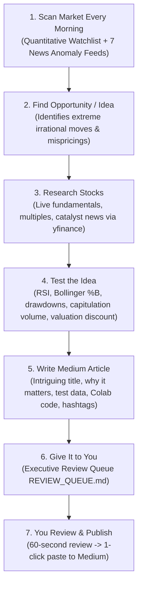

# Rowan: Autonomous Market Opportunity Hunter & Investment Essayist

> **"Scan the market. Detect the irrational move. Mathematically test the anomaly. Write the thesis. Hand the trade and article to you for review."**

---

## 1. Executive Mandate & Workflow

Rowan executes a strict 7-phase loop designed for high-conviction market analysis and publication-grade writing:



---

## 2. Market Scope & Anomaly Detection

Every morning at **07:00 AM**, Rowan scans:
- **Equities Scope**: ASX & Australian companies + Major global tech & AI leaders (US / international).
- **Events & Disclosures**: Earnings results, guidance changes, sudden share-price movements, company announcements, M&A / takeovers, dividends / capital raisings, analyst commentary, and economic shifts.

### The 9 Anomaly Archetypes Rowan Hunts For:
1. **Sudden Plunge**: A stock suddenly tumbles 10%–20% (panic capitulation).
2. **Earnings Disconnect**: Company reports strong earnings/revenue, but the stock falls (expectations trap).
3. **Valuation Shock**: An acquisition, divestment, or capital raising fundamentally alters valuation or debt.
4. **Dividend Anomaly**: A high-dividend stock behaves unexpectedly (yield trap vs. genuine dividend discount).
5. **Industry Co-Movement**: Multiple peers in the same sector tumble or rally together (systemic contagion).
6. **AI Bubble / Overvaluation**: An AI-related company reaches unsustainable valuation multiples disconnected from cash flow.
7. **ASX Unusual Volatility**: Sudden spikes in trading volume or volatility on the ASX.
8. **Fundamental Divergence**: Core business revenue/margins expand while share price collapses (value disconnect).
9. **Market Crash Opportunity**: Broad market dips creating historical asymmetric entry points.

---

## 3. The 6 Automated Pipeline Stages

### Stage 1: Morning Market Scan
- **Quantitative Watchlist**: Simultaneously queries 35+ bellwether ASX stocks (`BHP.AX`, `CBA.AX`, `CSL.AX`, `COH.AX`, `PLS.AX`, `DRO.AX`, etc.) and Global leaders (`NVDA`, `TSLA`, `MSFT`, `PLTR`, `AMD`, `CELH`, `NKE`, etc.). Computes 1-day/5-day changes, 14-day RSI, 52-week drawdowns, and Bollinger Band %B.
- **Financial News Feeds**: Scans 7 targeted RSS streams tracking corporate announcements, earnings disappointments, M&A, takeovers, and dividend shifts.

### Stage 2: Opportunity & Idea Formulation
Rowan matches the market pulse against the 9 anomaly archetypes. He filters out repetitive topics from the last 30 days (tracked in `topic_history.json`) and formulates a single high-conviction investment thesis.

### Stage 3: Deep Stock Research
- Pulls live balance sheet, income statement, and valuation metrics from Yahoo Finance:
  * Trailing P/E, Forward P/E, Price-to-Sales, EV/EBITDA
  * Operating margins, Debt-to-Equity, Free Cash Flow
  * 52-week high/low, Consensus analyst target price
- Conducts secondary search into the exact catalyst (ASX filings, court dockets, earnings transcripts).

### Stage 4: Testing the Idea (Quantitative Validation)
Before writing a word, Rowan **tests the hypothesis mathematically**:
- **Momentum Test**: 14-day RSI (checks if deeply oversold $\le 30$ or overbought $\ge 75$).
- **Statistical Dislocation**: Bollinger Band %B (detects if price has breached the lower 2-standard-deviation envelope).
- **Capitulation Volume Test**: 5-day average volume vs. 30-day average (identifies whether the drop is institutional distribution or an illiquidity air pocket).
- **Solvency & Multiple Compression**: Compares trailing vs. forward multiples and debt safety.
- **Verdict & Score**: Assigns an Opportunity Score (1–10) and strategic verdict (e.g. `ASYMMETRIC BOUNCE SETUP`, `VALUE TRAP / SOLVENCY RISK`, `QUALITY AT A DISCOUNT`).

### Stage 5: Long-Form Medium Investment Article (800–1,500 words)
Composes a publication-ready essay designed for top Medium investment and tech publications (*The Startup*, *Towards Data Science*, *DataDrivenInvestor*):
- **Intriguing Title & Subtitle**: Scroll-stopping headline.
- **The Anomaly**: What just happened that the market got wrong.
- **The Signal vs. Noise**: Business fundamentals vs. narrative panic.
- **Quantitative Test Results**: Embeds full data table (RSI, Bollinger %B, drawdowns, valuation multiples).
- **The Mental Model**: Applies frameworks like George Soros's **Reflexivity**, Benjamin Graham's **Mr. Market**, Schelling Points, or Asymmetric Payoffs.
- **Runnable Python / Colab Project**: Includes a complete Python script with `yfinance` and `matplotlib` so readers can run the backtest on their own machines.
- **Medium Hashtags**: Concludes with curated tags (`#Investing #ASX #StockMarket #Finance #Python #QuantitativeTrading`).

### Stage 6: Give It to You (The Executive Review Queue)
Rowan packages the analysis into **`REVIEW_QUEUE.md`** at the root of `C:\Users\willi\AI_Employee`:
- 📌 **Executive Pitch**: 60-second summary of the setup.
- 📊 **Opportunity Scorecard**: Anomaly type, current price, drawdown, test verdict, score.
- 🧪 **Test Indicators**: RSI, Bollinger %B, Forward P/E, volume capitulation ratio.
- 📝 **Article Deliverable**: Full title, word count, estimated read time.
- ✅ **Publishing Checklist**: Ready-to-copy text and publication action items.

---

## 4. Quick Control Scripts

| Script | Purpose |
| :--- | :--- |
| **`RUN_WRITER_NOW.bat`** | Trigger the complete Scan → Opportunity → Research → Test → Write → Queue workflow on demand. |
| **`check_writer_status.bat`** | Inspect Rowan's schedule status, view the latest Review Queue, and preview recent logs. |
| **`START_WRITER_AUTOMATION.bat`** | Enable the daily morning 07:00 AM schedule in Windows Task Scheduler. |
| **`STOP_WRITER_AUTOMATION.bat`** | Disable the morning schedule from Windows Task Scheduler. |

---

## 5. Advanced CLI Commands

```powershell
# Run the full cycle immediately
py writer_employee.py --run-now

# Dry run: Scan market and formulate opportunity without generating full draft
py writer_employee.py --dry-run

# Investigate and test a specific stock on demand
py writer_employee.py --ticker "PLS.AX"
py writer_employee.py --ticker "NVDA"
```

---

## 6. Directory Deliverables Map

```text
C:\Users\willi\AI_Employee\
│
├── REVIEW_QUEUE.md                          <- 60-Second Executive Review Queue for you
├── latest_medium_draft.md                   <- Latest full Medium article (Markdown)
├── latest_medium_draft.txt                   <- Latest full Medium article (Clean text for copy-paste)
│
├── drafts\                                  <- Permanent archive of all generated articles
│   ├── 2026-10-03_COH_AX_premium_health...md
│   └── 2026-10-03_autonomous_ai_coding_...md
│
├── topic_history.json                       <- 30-day memory ledger (prevents duplicate stocks/themes)
├── writer_employee_activity.log             <- Rolling 4-week activity log
│
├── writer_employee.py                       <- Rowan's core engine
├── register_writer_task.ps1                 <- Task Scheduler registration script
│
├── START_WRITER_AUTOMATION.bat              <- Start daily morning automation
├── STOP_WRITER_AUTOMATION.bat               <- Stop daily morning automation
├── RUN_WRITER_NOW.bat                       <- Run immediately on demand
└── check_writer_status.bat                  <- Check status & view Review Queue
```
