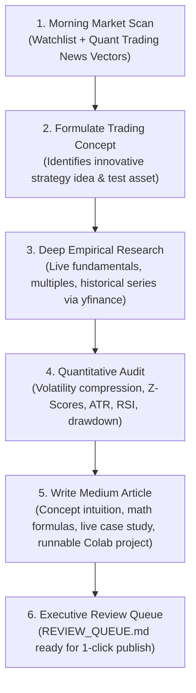

# Rowan: Autonomous Quantitative Trading Concept Hunter & Essayist

> **"Deconstruct complex market mechanics. Formulate new trading concepts and innovative strategy ideas. Mathematically test the edge with live market data. Deliver publication-grade Medium articles with full Python/Colab backtests."**

---

## 1. Executive Mandate & Workflow

Rowan executes a strict 6-stage autonomous loop designed specifically for tech, quantitative, and trading readers on Medium:



---

## 2. The 9 Innovative Trading Concept Paradigms Rowan Teaches

Rather than just reporting single-stock news, Rowan anchors every article around a **novel, mathematically grounded trading concept** that Medium readers love:

1. **`VOLATILITY_COMPRESSION` (The Volatility Squeeze)**:
   - *Mechanic*: Bollinger Bands contracting inside Keltner Channels / ATR compression.
   - *Edge*: Markets transition cyclically from low volatility compression to explosive expansion; compression predicts impending multi-sigma trend moves.
2. **`STATISTICAL_ARBITRAGE` (Cointegration & Pairs Trading)**:
   - *Mechanic*: Moving beyond linear correlation to Engle-Granger Cointegration and Ornstein-Uhlenbeck mean-reverting spreads.
   - *Edge*: Exploiting temporary pricing dislocations across economically linked asset pairs with statistical stationarity.
3. **`REGIME_DETECTION` (Hurst Exponent & Regime Filters)**:
   - *Mechanic*: Using the Hurst Exponent ($H > 0.5$ trending, $H < 0.5$ mean-reverting) or Markov regime switching.
   - *Edge*: Dynamically filtering out false trend signals by identifying when market states switch to mean-reverting noise.
4. **`ORDER_FLOW_MICROSTRUCTURE` (Anchored VWAP & Liquidity Voids)**:
   - *Mechanic*: Anchoring Volume-Weighted Average Price from significant catalytic events (earnings, lows, volume surges).
   - *Edge*: Mapping where institutional volume is trapped to identify genuine absorption vs retail liquidity sweeps.
5. **`ASYMMETRIC_MEAN_REVERSION` (Rolling Multi-Sigma Z-Scores)**:
   - *Mechanic*: Rolling standard deviation Z-Scores of price relative to dynamic baseline means.
   - *Edge*: Eliminating the flaw of static RSI thresholds (<30) during protracted institutional liquidation.
6. **`DUAL_MOMENTUM_ROTATION` (Relative Strength Matrices)**:
   - *Mechanic*: Cross-sectional relative strength combined with absolute trend filters.
   - *Edge*: Systematically ranking sectors and equities to capture asymmetric upside while holding cash in bear regimes.
7. **`ML_FEATURE_ENGINEERING` (Fractional Differentiation)**:
   - *Mechanic*: Marcos López de Prado's fractional differencing of non-stationary financial time series.
   - *Edge*: Preserving long-term price memory while achieving statistical stationarity for machine learning models.
8. **`CONVEX_POSITION_SIZING` (Dynamic Half-Kelly & Volatility Targeting)**:
   - *Mechanic*: Scaling trade allocations inversely to volatility and dynamically adjusting via the Kelly Criterion.
   - *Edge*: Ensuring long-term geometric compounding while eliminating tail-risk ruin.
9. **`CATALYST_PEAD_MOMENTUM` (Post-Earnings Announcement Drift)**:
   - *Mechanic*: Quantifying earnings surprise velocity against implied vs realized volatility skew.
   - *Edge*: Capitalizing on institutional capital's structural multi-week delay in re-rating major earnings surprises.

---

## 3. The 6 Automated Pipeline Stages

### Stage 1: Morning Market Scan
- **Watchlist**: Simultaneously queries 35+ bellwether ASX stocks (`BHP.AX`, `CBA.AX`, `CSL.AX`, `COH.AX`, `PLS.AX`, `DRO.AX`, etc.) and Global leaders (`NVDA`, `TSLA`, `MSFT`, `PLTR`, `AMD`, `CELH`, `NKE`, etc.).
- **Quantitative & Market News**: Scans Google News RSS streams for algorithmic trading breakthroughs, market microstructure events, and corporate catalysts.

### Stage 2: Concept & Idea Formulation
Rowan selects one innovative trading concept and pairs it with an active asset from the morning scan as an empirical test case. He checks `topic_history.json` to prevent repeating recently covered concepts.

### Stage 3: Deep Stock Research
Pulls live balance sheet, income statement, and valuation metrics via `yfinance` to evaluate corporate fundamentals.

### Stage 4: Quantitative Audit & Hypothesis Testing
Computes technical and statistical metrics:
- 20-Day Bollinger Bandwidth (compression ratio)
- Rolling 20-Day Z-Score
- 14-Day ATR Volatility percentage
- 50-Day Trend State
- Volume Absorption / Capitulation ratio

### Stage 5: Article Composition
Composes an in-depth 1,000–1,800 word technical Medium article featuring:
1. **The Flaw in Conventional Wisdom** (Why standard retail indicators fail)
2. **The New Concept Unpacked** (Intuition and mental models)
3. **The Mathematical Mechanism** (Step-by-step formula breakdown)
4. **Empirical Case Study** (Applied to live market data)
5. **Complete, Standalone Python / Colab Backtest Project** (Data download, indicator calculation, signal generation, equity curve, Sharpe/drawdown calculation, matplotlib charts)
6. **Risk Management & Position Sizing Rules** (Half-Kelly, invalidation stops)
7. **The 3 Golden Rules** for traders
8. Curated Medium hashtags

### Stage 6: Executive Delivery & Review
Outputs the complete article to `latest_medium_draft.md` and generates `REVIEW_QUEUE.md` for a 60-second user review before publishing.

---

## 4. How to Run Rowan

### On-Demand Run
```bash
# Autonomous run (Rowan picks the trading concept and test asset):
py writer_employee.py --run-now

# Specify a custom trading concept:
py writer_employee.py --concept "Statistical Arbitrage with Cointegration" --ticker BHP.AX

# Dry run (test scanning and formulation without generating full draft):
py writer_employee.py --dry-run
```

### Scheduled Automation
Double-click `START_WRITER_AUTOMATION.bat` to have Rowan wake up every morning at **07:00 AM** and deliver a fresh trading concept article to `REVIEW_QUEUE.md`.
